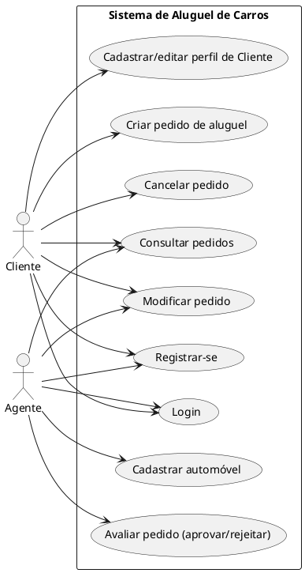
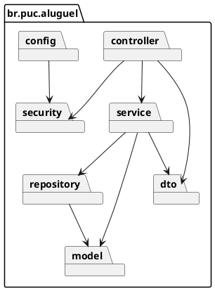

# Sistema de Aluguel de Carros Implementation Plan

> **For agentic workers:** REQUIRED SUB-SKILL: Use superpowers:subagent-driven-development (recommended) or superpowers:executing-plans to implement this plan task-by-task. Steps use checkbox (`- [ ]`) syntax for tracking.

**Goal:** Build the LAB02 car-rental system: Spring Boot 4 (Java 25) REST backend with MVC
layering and JWT auth, a React + Vite frontend, PostgreSQL via Supabase, plus the PlantUML
diagrams and README required by the assignment.

**Architecture:** Monorepo (`backend/`, `frontend/`, `docs/uml/`). Backend exposes JSON REST
API secured with Spring Security + JWT; roles `CLIENTE` and `AGENTE` gate endpoints. Frontend
is a Vite SPA calling the API with axios, storing the JWT and routing by role. Database schema
managed with Flyway migrations against Supabase Postgres (connection string/env supplied once
the Supabase project exists — see Task 0b).

**Tech Stack:** Java 25, Spring Boot 4.0.x, Spring Web, Spring Security, Spring Data JPA,
Flyway, Maven, PostgreSQL (Supabase), JUnit 5 + Mockito, React 18, Vite, React Router, axios.

---

## Task 0a: Backend project scaffold

**Files:**
- Create: `backend/pom.xml`
- Create: `backend/src/main/java/br/puc/aluguel/AluguelApplication.java`
- Create: `backend/src/main/resources/application.yml`
- Create: `backend/.gitignore`

- [ ] **Step 1: Generate the Maven project**

Use Spring Initializr (web UI or `curl`) for group `br.puc.aluguel`, artifact `aluguel-carros`,
Java 25, Spring Boot 4.0.x, dependencies: Spring Web, Spring Data JPA, Spring Security,
Validation, PostgreSQL Driver, Flyway Migration.

```bash
curl -G https://start.spring.io/starter.zip \
  -d type=maven-project -d language=java -d bootVersion=4.0.0 \
  -d baseDir=backend -d groupId=br.puc.aluguel -d artifactId=aluguel-carros \
  -d name=aluguel-carros -d packageName=br.puc.aluguel \
  -d javaVersion=25 \
  -d dependencies=web,data-jpa,security,validation,postgresql,flyway \
  -o backend.zip
unzip backend.zip -d backend
rm backend.zip
```

- [ ] **Step 2: Add JWT dependency to `backend/pom.xml`**

Add inside `<dependencies>`:

```xml
<dependency>
    <groupId>io.jsonwebtoken</groupId>
    <artifactId>jjwt-api</artifactId>
    <version>0.12.6</version>
</dependency>
<dependency>
    <groupId>io.jsonwebtoken</groupId>
    <artifactId>jjwt-impl</artifactId>
    <version>0.12.6</version>
    <scope>runtime</scope>
</dependency>
<dependency>
    <groupId>io.jsonwebtoken</groupId>
    <artifactId>jjwt-jackson</artifactId>
    <version>0.12.6</version>
    <scope>runtime</scope>
</dependency>
```

- [ ] **Step 3: Configure `backend/src/main/resources/application.yml`**

```yaml
server:
  port: 8080

spring:
  datasource:
    url: ${SUPABASE_DB_URL}
    username: ${SUPABASE_DB_USER}
    password: ${SUPABASE_DB_PASSWORD}
  jpa:
    hibernate:
      ddl-auto: validate
    properties:
      hibernate:
        format_sql: true
  flyway:
    enabled: true
    locations: classpath:db/migration

app:
  jwt:
    secret: ${JWT_SECRET:troque-este-segredo-em-producao-0123456789}
    expiration-ms: 86400000

cors:
  allowed-origins: http://localhost:5173
```

- [ ] **Step 4: Verify the app boots (will fail DB connection until Task 0b — expected)**

```bash
cd backend && ./mvnw -q spring-boot:run
```

Expected: fails on datasource connection (no Supabase credentials yet). Confirms the app
compiles and wires up to that point. Stop the process (Ctrl+C).

- [ ] **Step 5: Commit**

```bash
git add backend
git commit -m "chore: scaffold Spring Boot backend project"
```

---

## Task 0b: Supabase project + Vite frontend scaffold

**Files:**
- Create: `backend/.env.example`
- Create: `frontend/` (via `npm create vite@latest`)
- Create: `frontend/.env.example`

- [ ] **Step 1: Create the Supabase project**

Use the claude-in-chrome tools: open `https://supabase.com/dashboard`, let the user log in
manually, create a new project named `aluguel-carros`, region closest to the user. Once
provisioned, open Project Settings → Database and copy the connection string (use the
"Session pooler" URI, port 5432 or 6543), plus the DB password set during creation.

- [ ] **Step 2: Record credentials in `backend/.env.example` (placeholders only, real values
go in a local untracked `.env` or exported shell vars, never committed)**

```
SUPABASE_DB_URL=jdbc:postgresql://<host>:5432/postgres
SUPABASE_DB_USER=postgres
SUPABASE_DB_PASSWORD=
JWT_SECRET=
```

- [ ] **Step 3: Scaffold the frontend**

```bash
npm create vite@latest frontend -- --template react
cd frontend && npm install
npm install axios react-router-dom
```

- [ ] **Step 4: Configure `frontend/.env.example`**

```
VITE_API_URL=http://localhost:8080
```

- [ ] **Step 5: Verify frontend boots**

```bash
cd frontend && npm run dev -- --port 5173
```

Expected: Vite dev server starts, default React page loads at `http://localhost:5173`. Stop
with Ctrl+C.

- [ ] **Step 6: Commit**

```bash
git add frontend backend/.env.example frontend/.env.example
git commit -m "chore: scaffold Vite React frontend, add Supabase env template"
```

---

## Task 1: UML diagrams (PlantUML)

**Files:**
- Create: `docs/uml/casos-de-uso.puml`
- Create: `docs/uml/user-stories.md`
- Create: `docs/uml/diagrama-classes.puml`
- Create: `docs/uml/diagrama-pacotes.puml`

- [ ] **Step 1: Write the use case diagram**

`docs/uml/casos-de-uso.puml`:



- [ ] **Step 2: Write user stories**

`docs/uml/user-stories.md`:

```markdown
# Histórias de Usuário

1. Como Cliente, quero me registrar com meus dados pessoais para poder usar o sistema.
2. Como Cliente, quero fazer login para acessar meus pedidos.
3. Como Cliente, quero editar meus dados de perfil (RG, CPF, endereço, profissão,
   empregadores) para mantê-los atualizados.
4. Como Cliente, quero criar um pedido de aluguel para um automóvel disponível.
5. Como Cliente, quero consultar o status dos meus pedidos para saber se foram aprovados.
6. Como Cliente, quero modificar um pedido ainda não avaliado para corrigir dados.
7. Como Cliente, quero cancelar um pedido para desistir do aluguel.
8. Como Agente, quero listar os pedidos pendentes de avaliação para analisá-los.
9. Como Agente, quero aprovar ou rejeitar um pedido para dar andamento ao contrato.
10. Como Agente, quero cadastrar automóveis para que fiquem disponíveis para aluguel.
```

- [ ] **Step 3: Write the class diagram**

`docs/uml/diagrama-classes.puml`:

```plantuml
@startuml DiagramaClasses
enum Role { CLIENTE \n AGENTE }
enum TipoAgente { EMPRESA \n BANCO }
enum TipoProprietario { CLIENTE \n EMPRESA \n BANCO }
enum StatusPedido { INTRODUZIDO \n EM_ANALISE \n APROVADO \n REJEITADO \n EM_EXECUCAO \n CONCLUIDO \n CANCELADO }

class Usuario {
  Long id
  String login
  String senhaHash
  Role role
}

class Cliente {
  Long id
  String rg
  String cpf
  String nome
  String endereco
  String profissao
}

class Empregador {
  Long id
  String nome
  BigDecimal rendimento
}

class Agente {
  Long id
  TipoAgente tipo
  String nome
}

class Automovel {
  Long id
  String matricula
  Integer ano
  String marca
  String modelo
  String placa
  TipoProprietario tipoProprietario
  Long proprietarioId
}

class Pedido {
  Long id
  LocalDate dataPedido
  StatusPedido status
}

class Contrato {
  Long id
  LocalDate dataInicio
  LocalDate dataFim
  BigDecimal valor
}

class ContratoCredito {
  Long id
  BigDecimal valorFinanciado
  Integer parcelas
}

Usuario "1" -- "0..1" Cliente
Usuario "1" -- "0..1" Agente
Cliente "1" -- "0..3" Empregador
Cliente "1" -- "many" Pedido
Automovel "1" -- "many" Pedido
Pedido "1" -- "0..1" Contrato
Contrato "1" -- "0..1" ContratoCredito
Agente "1" -- "many" ContratoCredito : banco concede
@enduml
```

- [ ] **Step 4: Write the package diagram**

`docs/uml/diagrama-pacotes.puml`:



- [ ] **Step 5: Commit**

```bash
git add docs/uml
git commit -m "docs: add use case, user story, class and package diagrams"
```

---

## Task 2: Domain entities + Flyway migration

**Files:**
- Create: `backend/src/main/resources/db/migration/V1__schema_inicial.sql`
- Create: `backend/src/main/java/br/puc/aluguel/model/Role.java`
- Create: `backend/src/main/java/br/puc/aluguel/model/Usuario.java`
- Create: `backend/src/main/java/br/puc/aluguel/model/Cliente.java`
- Create: `backend/src/main/java/br/puc/aluguel/model/Empregador.java`
- Create: `backend/src/main/java/br/puc/aluguel/model/TipoAgente.java`
- Create: `backend/src/main/java/br/puc/aluguel/model/Agente.java`
- Create: `backend/src/main/java/br/puc/aluguel/model/TipoProprietario.java`
- Create: `backend/src/main/java/br/puc/aluguel/model/Automovel.java`
- Create: `backend/src/main/java/br/puc/aluguel/model/StatusPedido.java`
- Create: `backend/src/main/java/br/puc/aluguel/model/Pedido.java`
- Create: `backend/src/main/java/br/puc/aluguel/model/Contrato.java`
- Create: `backend/src/main/java/br/puc/aluguel/model/ContratoCredito.java`

- [ ] **Step 1: Write the Flyway migration**

`backend/src/main/resources/db/migration/V1__schema_inicial.sql`:

```sql
CREATE TABLE usuario (
    id BIGSERIAL PRIMARY KEY,
    login VARCHAR(100) NOT NULL UNIQUE,
    senha_hash VARCHAR(255) NOT NULL,
    role VARCHAR(20) NOT NULL
);

CREATE TABLE cliente (
    id BIGSERIAL PRIMARY KEY,
    usuario_id BIGINT NOT NULL UNIQUE REFERENCES usuario(id),
    rg VARCHAR(20) NOT NULL,
    cpf VARCHAR(14) NOT NULL UNIQUE,
    nome VARCHAR(150) NOT NULL,
    endereco VARCHAR(255) NOT NULL,
    profissao VARCHAR(100)
);

CREATE TABLE empregador (
    id BIGSERIAL PRIMARY KEY,
    cliente_id BIGINT NOT NULL REFERENCES cliente(id),
    nome VARCHAR(150) NOT NULL,
    rendimento NUMERIC(12,2) NOT NULL
);

CREATE TABLE agente (
    id BIGSERIAL PRIMARY KEY,
    usuario_id BIGINT NOT NULL UNIQUE REFERENCES usuario(id),
    tipo VARCHAR(20) NOT NULL,
    nome VARCHAR(150) NOT NULL
);

CREATE TABLE automovel (
    id BIGSERIAL PRIMARY KEY,
    matricula VARCHAR(30) NOT NULL UNIQUE,
    ano INT NOT NULL,
    marca VARCHAR(80) NOT NULL,
    modelo VARCHAR(80) NOT NULL,
    placa VARCHAR(10) NOT NULL UNIQUE,
    tipo_proprietario VARCHAR(20) NOT NULL,
    proprietario_id BIGINT NOT NULL
);

CREATE TABLE pedido (
    id BIGSERIAL PRIMARY KEY,
    cliente_id BIGINT NOT NULL REFERENCES cliente(id),
    automovel_id BIGINT NOT NULL REFERENCES automovel(id),
    data_pedido DATE NOT NULL,
    status VARCHAR(20) NOT NULL
);

CREATE TABLE contrato (
    id BIGSERIAL PRIMARY KEY,
    pedido_id BIGINT NOT NULL UNIQUE REFERENCES pedido(id),
    data_inicio DATE NOT NULL,
    data_fim DATE NOT NULL,
    valor NUMERIC(12,2) NOT NULL
);

CREATE TABLE contrato_credito (
    id BIGSERIAL PRIMARY KEY,
    contrato_id BIGINT NOT NULL UNIQUE REFERENCES contrato(id),
    agente_id BIGINT NOT NULL REFERENCES agente(id),
    valor_financiado NUMERIC(12,2) NOT NULL,
    parcelas INT NOT NULL
);
```

- [ ] **Step 2: Write enums**

`backend/src/main/java/br/puc/aluguel/model/Role.java`:
```java
package br.puc.aluguel.model;

public enum Role { CLIENTE, AGENTE }
```

`backend/src/main/java/br/puc/aluguel/model/TipoAgente.java`:
```java
package br.puc.aluguel.model;

public enum TipoAgente { EMPRESA, BANCO }
```

`backend/src/main/java/br/puc/aluguel/model/TipoProprietario.java`:
```java
package br.puc.aluguel.model;

public enum TipoProprietario { CLIENTE, EMPRESA, BANCO }
```

`backend/src/main/java/br/puc/aluguel/model/StatusPedido.java`:
```java
package br.puc.aluguel.model;

public enum StatusPedido {
    INTRODUZIDO, EM_ANALISE, APROVADO, REJEITADO, EM_EXECUCAO, CONCLUIDO, CANCELADO
}
```

- [ ] **Step 3: Write `Usuario.java`**

```java
package br.puc.aluguel.model;

import jakarta.persistence.*;

@Entity
@Table(name = "usuario")
public class Usuario {

    @Id
    @GeneratedValue(strategy = GenerationType.IDENTITY)
    private Long id;

    @Column(nullable = false, unique = true)
    private String login;

    @Column(name = "senha_hash", nullable = false)
    private String senhaHash;

    @Enumerated(EnumType.STRING)
    @Column(nullable = false)
    private Role role;

    public Long getId() { return id; }
    public void setId(Long id) { this.id = id; }
    public String getLogin() { return login; }
    public void setLogin(String login) { this.login = login; }
    public String getSenhaHash() { return senhaHash; }
    public void setSenhaHash(String senhaHash) { this.senhaHash = senhaHash; }
    public Role getRole() { return role; }
    public void setRole(Role role) { this.role = role; }
}
```

- [ ] **Step 4: Write `Cliente.java`**

```java
package br.puc.aluguel.model;

import jakarta.persistence.*;
import java.util.ArrayList;
import java.util.List;

@Entity
@Table(name = "cliente")
public class Cliente {

    @Id
    @GeneratedValue(strategy = GenerationType.IDENTITY)
    private Long id;

    @OneToOne
    @JoinColumn(name = "usuario_id", nullable = false, unique = true)
    private Usuario usuario;

    @Column(nullable = false)
    private String rg;

    @Column(nullable = false, unique = true)
    private String cpf;

    @Column(nullable = false)
    private String nome;

    @Column(nullable = false)
    private String endereco;

    private String profissao;

    @OneToMany(mappedBy = "cliente", cascade = CascadeType.ALL, orphanRemoval = true)
    private List<Empregador> empregadores = new ArrayList<>();

    public Long getId() { return id; }
    public void setId(Long id) { this.id = id; }
    public Usuario getUsuario() { return usuario; }
    public void setUsuario(Usuario usuario) { this.usuario = usuario; }
    public String getRg() { return rg; }
    public void setRg(String rg) { this.rg = rg; }
    public String getCpf() { return cpf; }
    public void setCpf(String cpf) { this.cpf = cpf; }
    public String getNome() { return nome; }
    public void setNome(String nome) { this.nome = nome; }
    public String getEndereco() { return endereco; }
    public void setEndereco(String endereco) { this.endereco = endereco; }
    public String getProfissao() { return profissao; }
    public void setProfissao(String profissao) { this.profissao = profissao; }
    public List<Empregador> getEmpregadores() { return empregadores; }
    public void setEmpregadores(List<Empregador> empregadores) { this.empregadores = empregadores; }
}
```

- [ ] **Step 5: Write `Empregador.java`**

```java
package br.puc.aluguel.model;

import jakarta.persistence.*;
import java.math.BigDecimal;

@Entity
@Table(name = "empregador")
public class Empregador {

    @Id
    @GeneratedValue(strategy = GenerationType.IDENTITY)
    private Long id;

    @ManyToOne
    @JoinColumn(name = "cliente_id", nullable = false)
    private Cliente cliente;

    @Column(nullable = false)
    private String nome;

    @Column(nullable = false)
    private BigDecimal rendimento;

    public Long getId() { return id; }
    public void setId(Long id) { this.id = id; }
    public Cliente getCliente() { return cliente; }
    public void setCliente(Cliente cliente) { this.cliente = cliente; }
    public String getNome() { return nome; }
    public void setNome(String nome) { this.nome = nome; }
    public BigDecimal getRendimento() { return rendimento; }
    public void setRendimento(BigDecimal rendimento) { this.rendimento = rendimento; }
}
```

- [ ] **Step 6: Write `Agente.java`**

```java
package br.puc.aluguel.model;

import jakarta.persistence.*;

@Entity
@Table(name = "agente")
public class Agente {

    @Id
    @GeneratedValue(strategy = GenerationType.IDENTITY)
    private Long id;

    @OneToOne
    @JoinColumn(name = "usuario_id", nullable = false, unique = true)
    private Usuario usuario;

    @Enumerated(EnumType.STRING)
    @Column(nullable = false)
    private TipoAgente tipo;

    @Column(nullable = false)
    private String nome;

    public Long getId() { return id; }
    public void setId(Long id) { this.id = id; }
    public Usuario getUsuario() { return usuario; }
    public void setUsuario(Usuario usuario) { this.usuario = usuario; }
    public TipoAgente getTipo() { return tipo; }
    public void setTipo(TipoAgente tipo) { this.tipo = tipo; }
    public String getNome() { return nome; }
    public void setNome(String nome) { this.nome = nome; }
}
```

- [ ] **Step 7: Write `Automovel.java`**

```java
package br.puc.aluguel.model;

import jakarta.persistence.*;

@Entity
@Table(name = "automovel")
public class Automovel {

    @Id
    @GeneratedValue(strategy = GenerationType.IDENTITY)
    private Long id;

    @Column(nullable = false, unique = true)
    private String matricula;

    @Column(nullable = false)
    private Integer ano;

    @Column(nullable = false)
    private String marca;

    @Column(nullable = false)
    private String modelo;

    @Column(nullable = false, unique = true)
    private String placa;

    @Enumerated(EnumType.STRING)
    @Column(name = "tipo_proprietario", nullable = false)
    private TipoProprietario tipoProprietario;

    @Column(name = "proprietario_id", nullable = false)
    private Long proprietarioId;

    public Long getId() { return id; }
    public void setId(Long id) { this.id = id; }
    public String getMatricula() { return matricula; }
    public void setMatricula(String matricula) { this.matricula = matricula; }
    public Integer getAno() { return ano; }
    public void setAno(Integer ano) { this.ano = ano; }
    public String getMarca() { return marca; }
    public void setMarca(String marca) { this.marca = marca; }
    public String getModelo() { return modelo; }
    public void setModelo(String modelo) { this.modelo = modelo; }
    public String getPlaca() { return placa; }
    public void setPlaca(String placa) { this.placa = placa; }
    public TipoProprietario getTipoProprietario() { return tipoProprietario; }
    public void setTipoProprietario(TipoProprietario tipoProprietario) { this.tipoProprietario = tipoProprietario; }
    public Long getProprietarioId() { return proprietarioId; }
    public void setProprietarioId(Long proprietarioId) { this.proprietarioId = proprietarioId; }
}
```

- [ ] **Step 8: Write `Pedido.java`**

```java
package br.puc.aluguel.model;

import jakarta.persistence.*;
import java.time.LocalDate;

@Entity
@Table(name = "pedido")
public class Pedido {

    @Id
    @GeneratedValue(strategy = GenerationType.IDENTITY)
    private Long id;

    @ManyToOne
    @JoinColumn(name = "cliente_id", nullable = false)
    private Cliente cliente;

    @ManyToOne
    @JoinColumn(name = "automovel_id", nullable = false)
    private Automovel automovel;

    @Column(name = "data_pedido", nullable = false)
    private LocalDate dataPedido;

    @Enumerated(EnumType.STRING)
    @Column(nullable = false)
    private StatusPedido status;

    public Long getId() { return id; }
    public void setId(Long id) { this.id = id; }
    public Cliente getCliente() { return cliente; }
    public void setCliente(Cliente cliente) { this.cliente = cliente; }
    public Automovel getAutomovel() { return automovel; }
    public void setAutomovel(Automovel automovel) { this.automovel = automovel; }
    public LocalDate getDataPedido() { return dataPedido; }
    public void setDataPedido(LocalDate dataPedido) { this.dataPedido = dataPedido; }
    public StatusPedido getStatus() { return status; }
    public void setStatus(StatusPedido status) { this.status = status; }
}
```

- [ ] **Step 9: Write `Contrato.java`**

```java
package br.puc.aluguel.model;

import jakarta.persistence.*;
import java.math.BigDecimal;
import java.time.LocalDate;

@Entity
@Table(name = "contrato")
public class Contrato {

    @Id
    @GeneratedValue(strategy = GenerationType.IDENTITY)
    private Long id;

    @OneToOne
    @JoinColumn(name = "pedido_id", nullable = false, unique = true)
    private Pedido pedido;

    @Column(name = "data_inicio", nullable = false)
    private LocalDate dataInicio;

    @Column(name = "data_fim", nullable = false)
    private LocalDate dataFim;

    @Column(nullable = false)
    private BigDecimal valor;

    public Long getId() { return id; }
    public void setId(Long id) { this.id = id; }
    public Pedido getPedido() { return pedido; }
    public void setPedido(Pedido pedido) { this.pedido = pedido; }
    public LocalDate getDataInicio() { return dataInicio; }
    public void setDataInicio(LocalDate dataInicio) { this.dataInicio = dataInicio; }
    public LocalDate getDataFim() { return dataFim; }
    public void setDataFim(LocalDate dataFim) { this.dataFim = dataFim; }
    public BigDecimal getValor() { return valor; }
    public void setValor(BigDecimal valor) { this.valor = valor; }
}
```

- [ ] **Step 10: Write `ContratoCredito.java`**

```java
package br.puc.aluguel.model;

import jakarta.persistence.*;
import java.math.BigDecimal;

@Entity
@Table(name = "contrato_credito")
public class ContratoCredito {

    @Id
    @GeneratedValue(strategy = GenerationType.IDENTITY)
    private Long id;

    @OneToOne
    @JoinColumn(name = "contrato_id", nullable = false, unique = true)
    private Contrato contrato;

    @ManyToOne
    @JoinColumn(name = "agente_id", nullable = false)
    private Agente agente;

    @Column(name = "valor_financiado", nullable = false)
    private BigDecimal valorFinanciado;

    @Column(nullable = false)
    private Integer parcelas;

    public Long getId() { return id; }
    public void setId(Long id) { this.id = id; }
    public Contrato getContrato() { return contrato; }
    public void setContrato(Contrato contrato) { this.contrato = contrato; }
    public Agente getAgente() { return agente; }
    public void setAgente(Agente agente) { this.agente = agente; }
    public BigDecimal getValorFinanciado() { return valorFinanciado; }
    public void setValorFinanciado(BigDecimal valorFinanciado) { this.valorFinanciado = valorFinanciado; }
    public Integer getParcelas() { return parcelas; }
    public void setParcelas(Integer parcelas) { this.parcelas = parcelas; }
}
```

- [ ] **Step 11: Verify it compiles**

```bash
cd backend && ./mvnw -q compile
```

Expected: `BUILD SUCCESS`.

- [ ] **Step 12: Commit**

```bash
git add backend/src/main/resources/db/migration backend/src/main/java/br/puc/aluguel/model
git commit -m "feat: add JPA entities and initial Flyway schema"
```

---

## Task 3: Repositories

**Files:**
- Create: `backend/src/main/java/br/puc/aluguel/repository/UsuarioRepository.java`
- Create: `backend/src/main/java/br/puc/aluguel/repository/ClienteRepository.java`
- Create: `backend/src/main/java/br/puc/aluguel/repository/AgenteRepository.java`
- Create: `backend/src/main/java/br/puc/aluguel/repository/AutomovelRepository.java`
- Create: `backend/src/main/java/br/puc/aluguel/repository/PedidoRepository.java`
- Create: `backend/src/main/java/br/puc/aluguel/repository/ContratoRepository.java`

- [ ] **Step 1: Write all repository interfaces**

`backend/src/main/java/br/puc/aluguel/repository/UsuarioRepository.java`:
```java
package br.puc.aluguel.repository;

import br.puc.aluguel.model.Usuario;
import org.springframework.data.jpa.repository.JpaRepository;
import java.util.Optional;

public interface UsuarioRepository extends JpaRepository<Usuario, Long> {
    Optional<Usuario> findByLogin(String login);
    boolean existsByLogin(String login);
}
```

`backend/src/main/java/br/puc/aluguel/repository/ClienteRepository.java`:
```java
package br.puc.aluguel.repository;

import br.puc.aluguel.model.Cliente;
import org.springframework.data.jpa.repository.JpaRepository;
import java.util.Optional;

public interface ClienteRepository extends JpaRepository<Cliente, Long> {
    Optional<Cliente> findByUsuarioId(Long usuarioId);
    boolean existsByCpf(String cpf);
}
```

`backend/src/main/java/br/puc/aluguel/repository/AgenteRepository.java`:
```java
package br.puc.aluguel.repository;

import br.puc.aluguel.model.Agente;
import org.springframework.data.jpa.repository.JpaRepository;
import java.util.Optional;

public interface AgenteRepository extends JpaRepository<Agente, Long> {
    Optional<Agente> findByUsuarioId(Long usuarioId);
}
```

`backend/src/main/java/br/puc/aluguel/repository/AutomovelRepository.java`:
```java
package br.puc.aluguel.repository;

import br.puc.aluguel.model.Automovel;
import org.springframework.data.jpa.repository.JpaRepository;

public interface AutomovelRepository extends JpaRepository<Automovel, Long> {
}
```

`backend/src/main/java/br/puc/aluguel/repository/PedidoRepository.java`:
```java
package br.puc.aluguel.repository;

import br.puc.aluguel.model.Pedido;
import br.puc.aluguel.model.StatusPedido;
import org.springframework.data.jpa.repository.JpaRepository;
import java.util.List;

public interface PedidoRepository extends JpaRepository<Pedido, Long> {
    List<Pedido> findByClienteId(Long clienteId);
    List<Pedido> findByStatus(StatusPedido status);
}
```

`backend/src/main/java/br/puc/aluguel/repository/ContratoRepository.java`:
```java
package br.puc.aluguel.repository;

import br.puc.aluguel.model.Contrato;
import org.springframework.data.jpa.repository.JpaRepository;

public interface ContratoRepository extends JpaRepository<Contrato, Long> {
}
```

- [ ] **Step 2: Verify compile**

```bash
cd backend && ./mvnw -q compile
```

Expected: `BUILD SUCCESS`.

- [ ] **Step 3: Commit**

```bash
git add backend/src/main/java/br/puc/aluguel/repository
git commit -m "feat: add Spring Data repositories"
```

---

## Task 4: JWT security (auth filter, config, UserDetails)

**Files:**
- Create: `backend/src/main/java/br/puc/aluguel/security/JwtService.java`
- Create: `backend/src/main/java/br/puc/aluguel/security/UsuarioDetails.java`
- Create: `backend/src/main/java/br/puc/aluguel/security/UsuarioDetailsService.java`
- Create: `backend/src/main/java/br/puc/aluguel/security/JwtAuthFilter.java`
- Create: `backend/src/main/java/br/puc/aluguel/config/SecurityConfig.java`
- Create: `backend/src/main/java/br/puc/aluguel/config/CorsConfig.java`
- Test: `backend/src/test/java/br/puc/aluguel/security/JwtServiceTest.java`

- [ ] **Step 1: Write the failing test for JwtService**

`backend/src/test/java/br/puc/aluguel/security/JwtServiceTest.java`:
```java
package br.puc.aluguel.security;

import org.junit.jupiter.api.BeforeEach;
import org.junit.jupiter.api.Test;
import static org.junit.jupiter.api.Assertions.*;

class JwtServiceTest {

    private JwtService jwtService;

    @BeforeEach
    void setUp() {
        jwtService = new JwtService("troque-este-segredo-em-producao-0123456789", 86400000);
    }

    @Test
    void geraTokenEExtraiLoginCorretamente() {
        String token = jwtService.gerarToken("cliente1@example.com");
        assertEquals("cliente1@example.com", jwtService.extrairLogin(token));
        assertTrue(jwtService.tokenValido(token, "cliente1@example.com"));
    }
}
```

- [ ] **Step 2: Run the test to verify it fails**

```bash
cd backend && ./mvnw -q test -Dtest=JwtServiceTest
```

Expected: FAIL — `JwtService` class not found.

- [ ] **Step 3: Write `JwtService.java`**

```java
package br.puc.aluguel.security;

import io.jsonwebtoken.Jwts;
import io.jsonwebtoken.security.Keys;
import org.springframework.beans.factory.annotation.Value;
import org.springframework.stereotype.Service;

import javax.crypto.SecretKey;
import java.nio.charset.StandardCharsets;
import java.util.Date;

@Service
public class JwtService {

    private final SecretKey key;
    private final long expirationMs;

    public JwtService(
            @Value("${app.jwt.secret}") String secret,
            @Value("${app.jwt.expiration-ms}") long expirationMs) {
        this.key = Keys.hmacShaKeyFor(secret.getBytes(StandardCharsets.UTF_8));
        this.expirationMs = expirationMs;
    }

    public String gerarToken(String login) {
        Date agora = new Date();
        Date expiracao = new Date(agora.getTime() + expirationMs);
        return Jwts.builder()
                .subject(login)
                .issuedAt(agora)
                .expiration(expiracao)
                .signWith(key)
                .compact();
    }

    public String extrairLogin(String token) {
        return Jwts.parser().verifyWith(key).build()
                .parseSignedClaims(token).getPayload().getSubject();
    }

    public boolean tokenValido(String token, String login) {
        try {
            String loginDoToken = extrairLogin(token);
            Date expiracao = Jwts.parser().verifyWith(key).build()
                    .parseSignedClaims(token).getPayload().getExpiration();
            return loginDoToken.equals(login) && expiracao.after(new Date());
        } catch (Exception e) {
            return false;
        }
    }
}
```

- [ ] **Step 4: Run the test to verify it passes**

```bash
cd backend && ./mvnw -q test -Dtest=JwtServiceTest
```

Expected: PASS.

- [ ] **Step 5: Write `UsuarioDetails.java`**

```java
package br.puc.aluguel.security;

import br.puc.aluguel.model.Usuario;
import org.springframework.security.core.GrantedAuthority;
import org.springframework.security.core.authority.SimpleGrantedAuthority;
import org.springframework.security.core.userdetails.UserDetails;

import java.util.Collection;
import java.util.List;

public class UsuarioDetails implements UserDetails {

    private final Usuario usuario;

    public UsuarioDetails(Usuario usuario) {
        this.usuario = usuario;
    }

    public Usuario getUsuario() { return usuario; }

    @Override
    public Collection<? extends GrantedAuthority> getAuthorities() {
        return List.of(new SimpleGrantedAuthority("ROLE_" + usuario.getRole().name()));
    }

    @Override
    public String getPassword() { return usuario.getSenhaHash(); }

    @Override
    public String getUsername() { return usuario.getLogin(); }

    @Override
    public boolean isAccountNonExpired() { return true; }

    @Override
    public boolean isAccountNonLocked() { return true; }

    @Override
    public boolean isCredentialsNonExpired() { return true; }

    @Override
    public boolean isEnabled() { return true; }
}
```

- [ ] **Step 6: Write `UsuarioDetailsService.java`**

```java
package br.puc.aluguel.security;

import br.puc.aluguel.repository.UsuarioRepository;
import org.springframework.security.core.userdetails.UserDetails;
import org.springframework.security.core.userdetails.UserDetailsService;
import org.springframework.security.core.userdetails.UsernameNotFoundException;
import org.springframework.stereotype.Service;

@Service
public class UsuarioDetailsService implements UserDetailsService {

    private final UsuarioRepository usuarioRepository;

    public UsuarioDetailsService(UsuarioRepository usuarioRepository) {
        this.usuarioRepository = usuarioRepository;
    }

    @Override
    public UserDetails loadUserByUsername(String login) throws UsernameNotFoundException {
        return usuarioRepository.findByLogin(login)
                .map(UsuarioDetails::new)
                .orElseThrow(() -> new UsernameNotFoundException("Usuário não encontrado: " + login));
    }
}
```

- [ ] **Step 7: Write `JwtAuthFilter.java`**

```java
package br.puc.aluguel.security;

import jakarta.servlet.FilterChain;
import jakarta.servlet.ServletException;
import jakarta.servlet.http.HttpServletRequest;
import jakarta.servlet.http.HttpServletResponse;
import org.springframework.lang.NonNull;
import org.springframework.security.authentication.UsernamePasswordAuthenticationToken;
import org.springframework.security.core.context.SecurityContextHolder;
import org.springframework.security.web.authentication.WebAuthenticationDetailsSource;
import org.springframework.stereotype.Component;
import org.springframework.web.filter.OncePerRequestFilter;

import java.io.IOException;

@Component
public class JwtAuthFilter extends OncePerRequestFilter {

    private final JwtService jwtService;
    private final UsuarioDetailsService usuarioDetailsService;

    public JwtAuthFilter(JwtService jwtService, UsuarioDetailsService usuarioDetailsService) {
        this.jwtService = jwtService;
        this.usuarioDetailsService = usuarioDetailsService;
    }

    @Override
    protected void doFilterInternal(
            @NonNull HttpServletRequest request,
            @NonNull HttpServletResponse response,
            @NonNull FilterChain filterChain) throws ServletException, IOException {

        String header = request.getHeader("Authorization");
        if (header == null || !header.startsWith("Bearer ")) {
            filterChain.doFilter(request, response);
            return;
        }

        String token = header.substring(7);
        String login = jwtService.extrairLogin(token);

        if (login != null && SecurityContextHolder.getContext().getAuthentication() == null) {
            UsuarioDetails userDetails = (UsuarioDetails) usuarioDetailsService.loadUserByUsername(login);
            if (jwtService.tokenValido(token, login)) {
                var authToken = new UsernamePasswordAuthenticationToken(
                        userDetails, null, userDetails.getAuthorities());
                authToken.setDetails(new WebAuthenticationDetailsSource().buildDetails(request));
                SecurityContextHolder.getContext().setAuthentication(authToken);
            }
        }
        filterChain.doFilter(request, response);
    }
}
```

- [ ] **Step 8: Write `SecurityConfig.java`**

```java
package br.puc.aluguel.config;

import br.puc.aluguel.security.JwtAuthFilter;
import org.springframework.context.annotation.Bean;
import org.springframework.context.annotation.Configuration;
import org.springframework.security.config.annotation.web.builders.HttpSecurity;
import org.springframework.security.config.annotation.web.configuration.EnableWebSecurity;
import org.springframework.security.config.http.SessionCreationPolicy;
import org.springframework.security.crypto.bcrypt.BCryptPasswordEncoder;
import org.springframework.security.crypto.password.PasswordEncoder;
import org.springframework.security.web.SecurityFilterChain;
import org.springframework.security.web.authentication.UsernamePasswordAuthenticationFilter;

@Configuration
@EnableWebSecurity
public class SecurityConfig {

    private final JwtAuthFilter jwtAuthFilter;

    public SecurityConfig(JwtAuthFilter jwtAuthFilter) {
        this.jwtAuthFilter = jwtAuthFilter;
    }

    @Bean
    public PasswordEncoder passwordEncoder() {
        return new BCryptPasswordEncoder();
    }

    @Bean
    public SecurityFilterChain filterChain(HttpSecurity http) throws Exception {
        http
            .csrf(csrf -> csrf.disable())
            .sessionManagement(sm -> sm.sessionCreationPolicy(SessionCreationPolicy.STATELESS))
            .authorizeHttpRequests(auth -> auth
                .requestMatchers("/auth/**").permitAll()
                .requestMatchers("/pedidos/avaliar/**").hasRole("AGENTE")
                .requestMatchers("/automoveis/**").hasRole("AGENTE")
                .anyRequest().authenticated()
            )
            .addFilterBefore(jwtAuthFilter, UsernamePasswordAuthenticationFilter.class);
        return http.build();
    }
}
```

- [ ] **Step 9: Write `CorsConfig.java`**

```java
package br.puc.aluguel.config;

import org.springframework.beans.factory.annotation.Value;
import org.springframework.context.annotation.Bean;
import org.springframework.context.annotation.Configuration;
import org.springframework.web.servlet.config.annotation.CorsRegistry;
import org.springframework.web.servlet.config.annotation.WebMvcConfigurer;

@Configuration
public class CorsConfig {

    @Value("${cors.allowed-origins}")
    private String allowedOrigins;

    @Bean
    public WebMvcConfigurer corsConfigurer() {
        return new WebMvcConfigurer() {
            @Override
            public void addCorsMappings(CorsRegistry registry) {
                registry.addMapping("/**")
                        .allowedOrigins(allowedOrigins)
                        .allowedMethods("GET", "POST", "PUT", "DELETE", "OPTIONS")
                        .allowedHeaders("*");
            }
        };
    }
}
```

- [ ] **Step 10: Run full test suite**

```bash
cd backend && ./mvnw -q test
```

Expected: PASS (JwtServiceTest green, app context not yet exercised).

- [ ] **Step 11: Commit**

```bash
git add backend/src/main/java/br/puc/aluguel/security backend/src/main/java/br/puc/aluguel/config backend/src/test/java/br/puc/aluguel/security
git commit -m "feat: add JWT auth filter and security config"
```

---

## Task 5: Auth endpoints (registro/login) + Cliente/Agente DTOs

**Files:**
- Create: `backend/src/main/java/br/puc/aluguel/dto/RegistroClienteRequest.java`
- Create: `backend/src/main/java/br/puc/aluguel/dto/RegistroAgenteRequest.java`
- Create: `backend/src/main/java/br/puc/aluguel/dto/LoginRequest.java`
- Create: `backend/src/main/java/br/puc/aluguel/dto/TokenResponse.java`
- Create: `backend/src/main/java/br/puc/aluguel/dto/EmpregadorRequest.java`
- Create: `backend/src/main/java/br/puc/aluguel/service/AuthService.java`
- Create: `backend/src/main/java/br/puc/aluguel/controller/AuthController.java`
- Test: `backend/src/test/java/br/puc/aluguel/service/AuthServiceTest.java`

- [ ] **Step 1: Write DTOs**

`backend/src/main/java/br/puc/aluguel/dto/EmpregadorRequest.java`:
```java
package br.puc.aluguel.dto;

import java.math.BigDecimal;

public record EmpregadorRequest(String nome, BigDecimal rendimento) {
}
```

`backend/src/main/java/br/puc/aluguel/dto/RegistroClienteRequest.java`:
```java
package br.puc.aluguel.dto;

import jakarta.validation.constraints.NotBlank;
import java.util.List;

public record RegistroClienteRequest(
        @NotBlank String login,
        @NotBlank String senha,
        @NotBlank String rg,
        @NotBlank String cpf,
        @NotBlank String nome,
        @NotBlank String endereco,
        String profissao,
        List<EmpregadorRequest> empregadores
) {
}
```

`backend/src/main/java/br/puc/aluguel/dto/RegistroAgenteRequest.java`:
```java
package br.puc.aluguel.dto;

import br.puc.aluguel.model.TipoAgente;
import jakarta.validation.constraints.NotBlank;
import jakarta.validation.constraints.NotNull;

public record RegistroAgenteRequest(
        @NotBlank String login,
        @NotBlank String senha,
        @NotNull TipoAgente tipo,
        @NotBlank String nome
) {
}
```

`backend/src/main/java/br/puc/aluguel/dto/LoginRequest.java`:
```java
package br.puc.aluguel.dto;

import jakarta.validation.constraints.NotBlank;

public record LoginRequest(@NotBlank String login, @NotBlank String senha) {
}
```

`backend/src/main/java/br/puc/aluguel/dto/TokenResponse.java`:
```java
package br.puc.aluguel.dto;

public record TokenResponse(String token, String role) {
}
```

- [ ] **Step 2: Write the failing test for AuthService**

`backend/src/test/java/br/puc/aluguel/service/AuthServiceTest.java`:
```java
package br.puc.aluguel.service;

import br.puc.aluguel.dto.EmpregadorRequest;
import br.puc.aluguel.dto.RegistroClienteRequest;
import br.puc.aluguel.model.Cliente;
import br.puc.aluguel.model.Usuario;
import br.puc.aluguel.repository.ClienteRepository;
import br.puc.aluguel.repository.UsuarioRepository;
import br.puc.aluguel.security.JwtService;
import org.junit.jupiter.api.Test;
import org.junit.jupiter.api.extension.ExtendWith;
import org.mockito.InjectMocks;
import org.mockito.Mock;
import org.mockito.junit.jupiter.MockitoExtension;
import org.springframework.security.crypto.bcrypt.BCryptPasswordEncoder;

import java.math.BigDecimal;
import java.util.List;
import java.util.Optional;

import static org.junit.jupiter.api.Assertions.*;
import static org.mockito.ArgumentMatchers.any;
import static org.mockito.Mockito.*;

@ExtendWith(MockitoExtension.class)
class AuthServiceTest {

    @Mock private UsuarioRepository usuarioRepository;
    @Mock private ClienteRepository clienteRepository;
    @Mock private JwtService jwtService;
    @InjectMocks private AuthService authService;

    @Test
    void registraClienteComAteTresEmpregadores() {
        var request = new RegistroClienteRequest(
                "cliente1", "senha123", "MG1234567", "12345678901", "Fulano de Tal",
                "Rua A, 1", "Engenheiro",
                List.of(new EmpregadorRequest("Empresa X", new BigDecimal("5000.00")))
        );

        when(usuarioRepository.existsByLogin("cliente1")).thenReturn(false);
        when(clienteRepository.existsByCpf("12345678901")).thenReturn(false);
        when(usuarioRepository.save(any(Usuario.class))).thenAnswer(inv -> {
            Usuario u = inv.getArgument(0);
            u.setId(1L);
            return u;
        });
        when(clienteRepository.save(any(Cliente.class))).thenAnswer(inv -> inv.getArgument(0));

        Cliente cliente = authService.registrarCliente(request);

        assertEquals("Fulano de Tal", cliente.getNome());
        assertEquals(1, cliente.getEmpregadores().size());
        verify(usuarioRepository).save(any(Usuario.class));
    }

    @Test
    void rejeitaClienteComMaisDeTresEmpregadores() {
        var request = new RegistroClienteRequest(
                "cliente2", "senha123", "MG1234567", "98765432100", "Ciclano",
                "Rua B, 2", "Médico",
                List.of(
                        new EmpregadorRequest("A", new BigDecimal("1000")),
                        new EmpregadorRequest("B", new BigDecimal("1000")),
                        new EmpregadorRequest("C", new BigDecimal("1000")),
                        new EmpregadorRequest("D", new BigDecimal("1000"))
                )
        );

        assertThrows(IllegalArgumentException.class, () -> authService.registrarCliente(request));
    }

    @Test
    void loginComCredenciaisValidasRetornaToken() {
        Usuario usuario = new Usuario();
        usuario.setId(1L);
        usuario.setLogin("cliente1");
        usuario.setSenhaHash(new BCryptPasswordEncoder().encode("senha123"));
        usuario.setRole(br.puc.aluguel.model.Role.CLIENTE);

        when(usuarioRepository.findByLogin("cliente1")).thenReturn(Optional.of(usuario));
        when(jwtService.gerarToken("cliente1")).thenReturn("token-fake");

        var resposta = authService.login(new br.puc.aluguel.dto.LoginRequest("cliente1", "senha123"));

        assertEquals("token-fake", resposta.token());
        assertEquals("CLIENTE", resposta.role());
    }
}
```

- [ ] **Step 3: Run the test to verify it fails**

```bash
cd backend && ./mvnw -q test -Dtest=AuthServiceTest
```

Expected: FAIL — `AuthService` not found.

- [ ] **Step 4: Write `AuthService.java`**

```java
package br.puc.aluguel.service;

import br.puc.aluguel.dto.*;
import br.puc.aluguel.model.*;
import br.puc.aluguel.repository.AgenteRepository;
import br.puc.aluguel.repository.ClienteRepository;
import br.puc.aluguel.repository.UsuarioRepository;
import br.puc.aluguel.security.JwtService;
import org.springframework.security.authentication.BadCredentialsException;
import org.springframework.security.crypto.password.PasswordEncoder;
import org.springframework.stereotype.Service;

import java.util.ArrayList;
import java.util.List;
import java.util.Optional;

@Service
public class AuthService {

    private final UsuarioRepository usuarioRepository;
    private final ClienteRepository clienteRepository;
    private final AgenteRepository agenteRepository;
    private final JwtService jwtService;
    private final PasswordEncoder passwordEncoder;

    public AuthService(
            UsuarioRepository usuarioRepository,
            ClienteRepository clienteRepository,
            AgenteRepository agenteRepository,
            JwtService jwtService,
            Optional<PasswordEncoder> passwordEncoder) {
        this.usuarioRepository = usuarioRepository;
        this.clienteRepository = clienteRepository;
        this.agenteRepository = agenteRepository;
        this.jwtService = jwtService;
        this.passwordEncoder = passwordEncoder.orElseGet(
                org.springframework.security.crypto.bcrypt.BCryptPasswordEncoder::new);
    }

    public Cliente registrarCliente(RegistroClienteRequest request) {
        if (request.empregadores() != null && request.empregadores().size() > 3) {
            throw new IllegalArgumentException("Cliente pode ter no máximo 3 empregadores");
        }
        if (usuarioRepository.existsByLogin(request.login())) {
            throw new IllegalArgumentException("Login já cadastrado");
        }
        if (clienteRepository.existsByCpf(request.cpf())) {
            throw new IllegalArgumentException("CPF já cadastrado");
        }

        Usuario usuario = new Usuario();
        usuario.setLogin(request.login());
        usuario.setSenhaHash(passwordEncoder.encode(request.senha()));
        usuario.setRole(Role.CLIENTE);
        usuario = usuarioRepository.save(usuario);

        Cliente cliente = new Cliente();
        cliente.setUsuario(usuario);
        cliente.setRg(request.rg());
        cliente.setCpf(request.cpf());
        cliente.setNome(request.nome());
        cliente.setEndereco(request.endereco());
        cliente.setProfissao(request.profissao());

        List<Empregador> empregadores = new ArrayList<>();
        if (request.empregadores() != null) {
            for (EmpregadorRequest er : request.empregadores()) {
                Empregador empregador = new Empregador();
                empregador.setCliente(cliente);
                empregador.setNome(er.nome());
                empregador.setRendimento(er.rendimento());
                empregadores.add(empregador);
            }
        }
        cliente.setEmpregadores(empregadores);

        return clienteRepository.save(cliente);
    }

    public Agente registrarAgente(RegistroAgenteRequest request) {
        if (usuarioRepository.existsByLogin(request.login())) {
            throw new IllegalArgumentException("Login já cadastrado");
        }

        Usuario usuario = new Usuario();
        usuario.setLogin(request.login());
        usuario.setSenhaHash(passwordEncoder.encode(request.senha()));
        usuario.setRole(Role.AGENTE);
        usuario = usuarioRepository.save(usuario);

        Agente agente = new Agente();
        agente.setUsuario(usuario);
        agente.setTipo(request.tipo());
        agente.setNome(request.nome());

        return agenteRepository.save(agente);
    }

    public TokenResponse login(LoginRequest request) {
        Usuario usuario = usuarioRepository.findByLogin(request.login())
                .orElseThrow(() -> new BadCredentialsException("Credenciais inválidas"));

        if (!passwordEncoder.matches(request.senha(), usuario.getSenhaHash())) {
            throw new BadCredentialsException("Credenciais inválidas");
        }

        String token = jwtService.gerarToken(usuario.getLogin());
        return new TokenResponse(token, usuario.getRole().name());
    }
}
```

- [ ] **Step 5: Run the test to verify it passes**

```bash
cd backend && ./mvnw -q test -Dtest=AuthServiceTest
```

Expected: PASS (all 3 tests).

- [ ] **Step 6: Write `AuthController.java`**

```java
package br.puc.aluguel.controller;

import br.puc.aluguel.dto.*;
import br.puc.aluguel.service.AuthService;
import jakarta.validation.Valid;
import org.springframework.http.ResponseEntity;
import org.springframework.web.bind.annotation.*;

@RestController
@RequestMapping("/auth")
public class AuthController {

    private final AuthService authService;

    public AuthController(AuthService authService) {
        this.authService = authService;
    }

    @PostMapping("/registrar/cliente")
    public ResponseEntity<Void> registrarCliente(@Valid @RequestBody RegistroClienteRequest request) {
        authService.registrarCliente(request);
        return ResponseEntity.ok().build();
    }

    @PostMapping("/registrar/agente")
    public ResponseEntity<Void> registrarAgente(@Valid @RequestBody RegistroAgenteRequest request) {
        authService.registrarAgente(request);
        return ResponseEntity.ok().build();
    }

    @PostMapping("/login")
    public ResponseEntity<TokenResponse> login(@Valid @RequestBody LoginRequest request) {
        return ResponseEntity.ok(authService.login(request));
    }
}
```

- [ ] **Step 7: Commit**

```bash
git add backend/src/main/java/br/puc/aluguel/dto backend/src/main/java/br/puc/aluguel/service/AuthService.java backend/src/main/java/br/puc/aluguel/controller/AuthController.java backend/src/test/java/br/puc/aluguel/service/AuthServiceTest.java
git commit -m "feat: add auth service, controller and registration/login tests"
```

---

## Task 6: Cliente CRUD (self-service profile)

**Files:**
- Create: `backend/src/main/java/br/puc/aluguel/dto/ClienteResponse.java`
- Create: `backend/src/main/java/br/puc/aluguel/dto/AtualizarClienteRequest.java`
- Create: `backend/src/main/java/br/puc/aluguel/service/ClienteService.java`
- Create: `backend/src/main/java/br/puc/aluguel/controller/ClienteController.java`
- Test: `backend/src/test/java/br/puc/aluguel/service/ClienteServiceTest.java`

- [ ] **Step 1: Write DTOs**

`backend/src/main/java/br/puc/aluguel/dto/ClienteResponse.java`:
```java
package br.puc.aluguel.dto;

import java.util.List;

public record ClienteResponse(
        Long id, String rg, String cpf, String nome, String endereco,
        String profissao, List<EmpregadorRequest> empregadores
) {
}
```

`backend/src/main/java/br/puc/aluguel/dto/AtualizarClienteRequest.java`:
```java
package br.puc.aluguel.dto;

import jakarta.validation.constraints.NotBlank;
import java.util.List;

public record AtualizarClienteRequest(
        @NotBlank String rg,
        @NotBlank String endereco,
        String profissao,
        List<EmpregadorRequest> empregadores
) {
}
```

- [ ] **Step 2: Write the failing test**

`backend/src/test/java/br/puc/aluguel/service/ClienteServiceTest.java`:
```java
package br.puc.aluguel.service;

import br.puc.aluguel.dto.AtualizarClienteRequest;
import br.puc.aluguel.dto.EmpregadorRequest;
import br.puc.aluguel.model.Cliente;
import br.puc.aluguel.repository.ClienteRepository;
import org.junit.jupiter.api.Test;
import org.junit.jupiter.api.extension.ExtendWith;
import org.mockito.InjectMocks;
import org.mockito.Mock;
import org.mockito.junit.jupiter.MockitoExtension;

import java.math.BigDecimal;
import java.util.List;
import java.util.Optional;

import static org.junit.jupiter.api.Assertions.*;
import static org.mockito.ArgumentMatchers.any;
import static org.mockito.Mockito.*;

@ExtendWith(MockitoExtension.class)
class ClienteServiceTest {

    @Mock private ClienteRepository clienteRepository;
    @InjectMocks private ClienteService clienteService;

    @Test
    void atualizaDadosDoClienteSubstituindoEmpregadores() {
        Cliente cliente = new Cliente();
        cliente.setId(1L);
        cliente.setRg("MG0000001");
        cliente.setEndereco("Endereço antigo");

        when(clienteRepository.findById(1L)).thenReturn(Optional.of(cliente));
        when(clienteRepository.save(any(Cliente.class))).thenAnswer(inv -> inv.getArgument(0));

        var request = new AtualizarClienteRequest(
                "MG1111111", "Endereço novo", "Advogado",
                List.of(new EmpregadorRequest("Nova Empresa", new BigDecimal("3000")))
        );

        Cliente atualizado = clienteService.atualizar(1L, request);

        assertEquals("MG1111111", atualizado.getRg());
        assertEquals("Endereço novo", atualizado.getEndereco());
        assertEquals(1, atualizado.getEmpregadores().size());
    }

    @Test
    void rejeitaAtualizacaoComMaisDeTresEmpregadores() {
        Cliente cliente = new Cliente();
        cliente.setId(1L);
        when(clienteRepository.findById(1L)).thenReturn(Optional.of(cliente));

        var request = new AtualizarClienteRequest(
                "MG1111111", "Endereço novo", "Advogado",
                List.of(
                        new EmpregadorRequest("A", BigDecimal.ONE),
                        new EmpregadorRequest("B", BigDecimal.ONE),
                        new EmpregadorRequest("C", BigDecimal.ONE),
                        new EmpregadorRequest("D", BigDecimal.ONE)
                )
        );

        assertThrows(IllegalArgumentException.class, () -> clienteService.atualizar(1L, request));
    }
}
```

- [ ] **Step 3: Run the test to verify it fails**

```bash
cd backend && ./mvnw -q test -Dtest=ClienteServiceTest
```

Expected: FAIL — `ClienteService` not found.

- [ ] **Step 4: Write `ClienteService.java`**

```java
package br.puc.aluguel.service;

import br.puc.aluguel.dto.AtualizarClienteRequest;
import br.puc.aluguel.dto.EmpregadorRequest;
import br.puc.aluguel.model.Cliente;
import br.puc.aluguel.model.Empregador;
import br.puc.aluguel.repository.ClienteRepository;
import org.springframework.stereotype.Service;

import java.util.ArrayList;
import java.util.List;

@Service
public class ClienteService {

    private final ClienteRepository clienteRepository;

    public ClienteService(ClienteRepository clienteRepository) {
        this.clienteRepository = clienteRepository;
    }

    public Cliente buscarPorId(Long id) {
        return clienteRepository.findById(id)
                .orElseThrow(() -> new IllegalArgumentException("Cliente não encontrado"));
    }

    public Cliente buscarPorUsuarioId(Long usuarioId) {
        return clienteRepository.findByUsuarioId(usuarioId)
                .orElseThrow(() -> new IllegalArgumentException("Cliente não encontrado"));
    }

    public Cliente atualizar(Long id, AtualizarClienteRequest request) {
        if (request.empregadores() != null && request.empregadores().size() > 3) {
            throw new IllegalArgumentException("Cliente pode ter no máximo 3 empregadores");
        }

        Cliente cliente = buscarPorId(id);
        cliente.setRg(request.rg());
        cliente.setEndereco(request.endereco());
        cliente.setProfissao(request.profissao());

        cliente.getEmpregadores().clear();
        List<Empregador> novos = new ArrayList<>();
        if (request.empregadores() != null) {
            for (EmpregadorRequest er : request.empregadores()) {
                Empregador empregador = new Empregador();
                empregador.setCliente(cliente);
                empregador.setNome(er.nome());
                empregador.setRendimento(er.rendimento());
                novos.add(empregador);
            }
        }
        cliente.getEmpregadores().addAll(novos);

        return clienteRepository.save(cliente);
    }

    public void excluir(Long id) {
        clienteRepository.deleteById(id);
    }
}
```

- [ ] **Step 5: Run the test to verify it passes**

```bash
cd backend && ./mvnw -q test -Dtest=ClienteServiceTest
```

Expected: PASS (both tests).

- [ ] **Step 6: Write `ClienteController.java`**

```java
package br.puc.aluguel.controller;

import br.puc.aluguel.dto.AtualizarClienteRequest;
import br.puc.aluguel.dto.ClienteResponse;
import br.puc.aluguel.dto.EmpregadorRequest;
import br.puc.aluguel.model.Cliente;
import br.puc.aluguel.security.UsuarioDetails;
import br.puc.aluguel.service.ClienteService;
import jakarta.validation.Valid;
import org.springframework.http.ResponseEntity;
import org.springframework.security.core.annotation.AuthenticationPrincipal;
import org.springframework.web.bind.annotation.*;

import java.util.List;

@RestController
@RequestMapping("/clientes")
public class ClienteController {

    private final ClienteService clienteService;

    public ClienteController(ClienteService clienteService) {
        this.clienteService = clienteService;
    }

    @GetMapping("/me")
    public ResponseEntity<ClienteResponse> meuPerfil(@AuthenticationPrincipal UsuarioDetails principal) {
        Cliente cliente = clienteService.buscarPorUsuarioId(principal.getUsuario().getId());
        return ResponseEntity.ok(toResponse(cliente));
    }

    @PutMapping("/me")
    public ResponseEntity<ClienteResponse> atualizarMeuPerfil(
            @AuthenticationPrincipal UsuarioDetails principal,
            @Valid @RequestBody AtualizarClienteRequest request) {
        Cliente cliente = clienteService.buscarPorUsuarioId(principal.getUsuario().getId());
        Cliente atualizado = clienteService.atualizar(cliente.getId(), request);
        return ResponseEntity.ok(toResponse(atualizado));
    }

    private ClienteResponse toResponse(Cliente cliente) {
        List<EmpregadorRequest> empregadores = cliente.getEmpregadores().stream()
                .map(e -> new EmpregadorRequest(e.getNome(), e.getRendimento()))
                .toList();
        return new ClienteResponse(
                cliente.getId(), cliente.getRg(), cliente.getCpf(), cliente.getNome(),
                cliente.getEndereco(), cliente.getProfissao(), empregadores
        );
    }
}
```

- [ ] **Step 7: Commit**

```bash
git add backend/src/main/java/br/puc/aluguel/dto/ClienteResponse.java backend/src/main/java/br/puc/aluguel/dto/AtualizarClienteRequest.java backend/src/main/java/br/puc/aluguel/service/ClienteService.java backend/src/main/java/br/puc/aluguel/controller/ClienteController.java backend/src/test/java/br/puc/aluguel/service/ClienteServiceTest.java
git commit -m "feat: add Cliente self-service profile CRUD"
```

---

## Task 7: Automovel CRUD (agente)

**Files:**
- Create: `backend/src/main/java/br/puc/aluguel/dto/AutomovelRequest.java`
- Create: `backend/src/main/java/br/puc/aluguel/dto/AutomovelResponse.java`
- Create: `backend/src/main/java/br/puc/aluguel/service/AutomovelService.java`
- Create: `backend/src/main/java/br/puc/aluguel/controller/AutomovelController.java`

- [ ] **Step 1: Write DTOs**

`backend/src/main/java/br/puc/aluguel/dto/AutomovelRequest.java`:
```java
package br.puc.aluguel.dto;

import br.puc.aluguel.model.TipoProprietario;
import jakarta.validation.constraints.NotBlank;
import jakarta.validation.constraints.NotNull;

public record AutomovelRequest(
        @NotBlank String matricula,
        @NotNull Integer ano,
        @NotBlank String marca,
        @NotBlank String modelo,
        @NotBlank String placa,
        @NotNull TipoProprietario tipoProprietario,
        @NotNull Long proprietarioId
) {
}
```

`backend/src/main/java/br/puc/aluguel/dto/AutomovelResponse.java`:
```java
package br.puc.aluguel.dto;

import br.puc.aluguel.model.TipoProprietario;

public record AutomovelResponse(
        Long id, String matricula, Integer ano, String marca, String modelo,
        String placa, TipoProprietario tipoProprietario, Long proprietarioId
) {
}
```

- [ ] **Step 2: Write `AutomovelService.java`**

```java
package br.puc.aluguel.service;

import br.puc.aluguel.dto.AutomovelRequest;
import br.puc.aluguel.model.Automovel;
import br.puc.aluguel.repository.AutomovelRepository;
import org.springframework.stereotype.Service;

import java.util.List;

@Service
public class AutomovelService {

    private final AutomovelRepository automovelRepository;

    public AutomovelService(AutomovelRepository automovelRepository) {
        this.automovelRepository = automovelRepository;
    }

    public List<Automovel> listarTodos() {
        return automovelRepository.findAll();
    }

    public Automovel buscarPorId(Long id) {
        return automovelRepository.findById(id)
                .orElseThrow(() -> new IllegalArgumentException("Automóvel não encontrado"));
    }

    public Automovel criar(AutomovelRequest request) {
        Automovel automovel = new Automovel();
        aplicar(automovel, request);
        return automovelRepository.save(automovel);
    }

    public Automovel atualizar(Long id, AutomovelRequest request) {
        Automovel automovel = buscarPorId(id);
        aplicar(automovel, request);
        return automovelRepository.save(automovel);
    }

    public void excluir(Long id) {
        automovelRepository.deleteById(id);
    }

    private void aplicar(Automovel automovel, AutomovelRequest request) {
        automovel.setMatricula(request.matricula());
        automovel.setAno(request.ano());
        automovel.setMarca(request.marca());
        automovel.setModelo(request.modelo());
        automovel.setPlaca(request.placa());
        automovel.setTipoProprietario(request.tipoProprietario());
        automovel.setProprietarioId(request.proprietarioId());
    }
}
```

- [ ] **Step 3: Write `AutomovelController.java`**

```java
package br.puc.aluguel.controller;

import br.puc.aluguel.dto.AutomovelRequest;
import br.puc.aluguel.dto.AutomovelResponse;
import br.puc.aluguel.model.Automovel;
import br.puc.aluguel.service.AutomovelService;
import jakarta.validation.Valid;
import org.springframework.http.ResponseEntity;
import org.springframework.web.bind.annotation.*;

import java.util.List;

@RestController
@RequestMapping("/automoveis")
public class AutomovelController {

    private final AutomovelService automovelService;

    public AutomovelController(AutomovelService automovelService) {
        this.automovelService = automovelService;
    }

    @GetMapping
    public ResponseEntity<List<AutomovelResponse>> listar() {
        return ResponseEntity.ok(automovelService.listarTodos().stream().map(this::toResponse).toList());
    }

    @PostMapping
    public ResponseEntity<AutomovelResponse> criar(@Valid @RequestBody AutomovelRequest request) {
        return ResponseEntity.ok(toResponse(automovelService.criar(request)));
    }

    @PutMapping("/{id}")
    public ResponseEntity<AutomovelResponse> atualizar(
            @PathVariable Long id, @Valid @RequestBody AutomovelRequest request) {
        return ResponseEntity.ok(toResponse(automovelService.atualizar(id, request)));
    }

    @DeleteMapping("/{id}")
    public ResponseEntity<Void> excluir(@PathVariable Long id) {
        automovelService.excluir(id);
        return ResponseEntity.noContent().build();
    }

    private AutomovelResponse toResponse(Automovel a) {
        return new AutomovelResponse(
                a.getId(), a.getMatricula(), a.getAno(), a.getMarca(), a.getModelo(),
                a.getPlaca(), a.getTipoProprietario(), a.getProprietarioId()
        );
    }
}
```

Note: `GET /automoveis` must be readable by clients too (to pick a car when creating a
pedido). Update `SecurityConfig` from Task 4 so only mutating automóvel endpoints require
`AGENTE`:

- [ ] **Step 4: Adjust `SecurityConfig.java`**

Replace the `/automoveis/**` rule:

```java
                .requestMatchers(org.springframework.http.HttpMethod.GET, "/automoveis/**").authenticated()
                .requestMatchers("/automoveis/**").hasRole("AGENTE")
```

(Place the GET rule before the blanket `/automoveis/**` rule in the `authorizeHttpRequests`
chain, since Spring Security matches rules in order.)

- [ ] **Step 5: Verify compile and existing tests**

```bash
cd backend && ./mvnw -q test
```

Expected: `BUILD SUCCESS`, all previous tests still pass.

- [ ] **Step 6: Commit**

```bash
git add backend/src/main/java/br/puc/aluguel/dto/AutomovelRequest.java backend/src/main/java/br/puc/aluguel/dto/AutomovelResponse.java backend/src/main/java/br/puc/aluguel/service/AutomovelService.java backend/src/main/java/br/puc/aluguel/controller/AutomovelController.java backend/src/main/java/br/puc/aluguel/config/SecurityConfig.java
git commit -m "feat: add Automovel CRUD, restrict mutation to AGENTE role"
```

---

## Task 8: Pedido flow (criar, consultar, modificar, cancelar, avaliar) + auto-Contrato

**Files:**
- Create: `backend/src/main/java/br/puc/aluguel/dto/PedidoRequest.java`
- Create: `backend/src/main/java/br/puc/aluguel/dto/PedidoResponse.java`
- Create: `backend/src/main/java/br/puc/aluguel/dto/AvaliarPedidoRequest.java`
- Create: `backend/src/main/java/br/puc/aluguel/service/PedidoService.java`
- Create: `backend/src/main/java/br/puc/aluguel/controller/PedidoController.java`
- Test: `backend/src/test/java/br/puc/aluguel/service/PedidoServiceTest.java`

- [ ] **Step 1: Write DTOs**

`backend/src/main/java/br/puc/aluguel/dto/PedidoRequest.java`:
```java
package br.puc.aluguel.dto;

import jakarta.validation.constraints.NotNull;

public record PedidoRequest(@NotNull Long automovelId) {
}
```

`backend/src/main/java/br/puc/aluguel/dto/PedidoResponse.java`:
```java
package br.puc.aluguel.dto;

import br.puc.aluguel.model.StatusPedido;
import java.time.LocalDate;

public record PedidoResponse(
        Long id, Long clienteId, Long automovelId, LocalDate dataPedido, StatusPedido status
) {
}
```

`backend/src/main/java/br/puc/aluguel/dto/AvaliarPedidoRequest.java`:
```java
package br.puc.aluguel.dto;

import jakarta.validation.constraints.NotNull;

public record AvaliarPedidoRequest(@NotNull Boolean aprovado) {
}
```

- [ ] **Step 2: Write the failing test**

`backend/src/test/java/br/puc/aluguel/service/PedidoServiceTest.java`:
```java
package br.puc.aluguel.service;

import br.puc.aluguel.dto.AvaliarPedidoRequest;
import br.puc.aluguel.dto.PedidoRequest;
import br.puc.aluguel.model.*;
import br.puc.aluguel.repository.AutomovelRepository;
import br.puc.aluguel.repository.ContratoRepository;
import br.puc.aluguel.repository.PedidoRepository;
import org.junit.jupiter.api.Test;
import org.junit.jupiter.api.extension.ExtendWith;
import org.mockito.InjectMocks;
import org.mockito.Mock;
import org.mockito.junit.jupiter.MockitoExtension;

import java.math.BigDecimal;
import java.util.Optional;

import static org.junit.jupiter.api.Assertions.*;
import static org.mockito.ArgumentMatchers.any;
import static org.mockito.Mockito.*;

@ExtendWith(MockitoExtension.class)
class PedidoServiceTest {

    @Mock private PedidoRepository pedidoRepository;
    @Mock private AutomovelRepository automovelRepository;
    @Mock private ContratoRepository contratoRepository;
    @InjectMocks private PedidoService pedidoService;

    @Test
    void criaPedidoComStatusIntroduzido() {
        Cliente cliente = new Cliente();
        cliente.setId(1L);
        Automovel automovel = new Automovel();
        automovel.setId(2L);

        when(automovelRepository.findById(2L)).thenReturn(Optional.of(automovel));
        when(pedidoRepository.save(any(Pedido.class))).thenAnswer(inv -> inv.getArgument(0));

        Pedido pedido = pedidoService.criar(cliente, new PedidoRequest(2L));

        assertEquals(StatusPedido.INTRODUZIDO, pedido.getStatus());
        assertEquals(automovel, pedido.getAutomovel());
    }

    @Test
    void aprovarPedidoCriaContratoEAtualizaStatus() {
        Pedido pedido = new Pedido();
        pedido.setId(10L);
        pedido.setStatus(StatusPedido.EM_ANALISE);

        when(pedidoRepository.findById(10L)).thenReturn(Optional.of(pedido));
        when(pedidoRepository.save(any(Pedido.class))).thenAnswer(inv -> inv.getArgument(0));
        when(contratoRepository.save(any(Contrato.class))).thenAnswer(inv -> inv.getArgument(0));

        Pedido avaliado = pedidoService.avaliar(10L, new AvaliarPedidoRequest(true));

        assertEquals(StatusPedido.APROVADO, avaliado.getStatus());
        verify(contratoRepository).save(any(Contrato.class));
    }

    @Test
    void rejeitarPedidoNaoCriaContrato() {
        Pedido pedido = new Pedido();
        pedido.setId(11L);
        pedido.setStatus(StatusPedido.EM_ANALISE);

        when(pedidoRepository.findById(11L)).thenReturn(Optional.of(pedido));
        when(pedidoRepository.save(any(Pedido.class))).thenAnswer(inv -> inv.getArgument(0));

        Pedido avaliado = pedidoService.avaliar(11L, new AvaliarPedidoRequest(false));

        assertEquals(StatusPedido.REJEITADO, avaliado.getStatus());
        verify(contratoRepository, never()).save(any(Contrato.class));
    }

    @Test
    void cancelarPedidoJaAprovadoLancaExcecao() {
        Pedido pedido = new Pedido();
        pedido.setId(12L);
        pedido.setStatus(StatusPedido.APROVADO);

        when(pedidoRepository.findById(12L)).thenReturn(Optional.of(pedido));

        assertThrows(IllegalStateException.class, () -> pedidoService.cancelar(12L));
    }
}
```

- [ ] **Step 3: Run the test to verify it fails**

```bash
cd backend && ./mvnw -q test -Dtest=PedidoServiceTest
```

Expected: FAIL — `PedidoService` not found.

- [ ] **Step 4: Write `PedidoService.java`**

```java
package br.puc.aluguel.service;

import br.puc.aluguel.dto.AvaliarPedidoRequest;
import br.puc.aluguel.dto.PedidoRequest;
import br.puc.aluguel.model.*;
import br.puc.aluguel.repository.AutomovelRepository;
import br.puc.aluguel.repository.ContratoRepository;
import br.puc.aluguel.repository.PedidoRepository;
import org.springframework.stereotype.Service;

import java.math.BigDecimal;
import java.time.LocalDate;
import java.util.List;

@Service
public class PedidoService {

    private final PedidoRepository pedidoRepository;
    private final AutomovelRepository automovelRepository;
    private final ContratoRepository contratoRepository;

    public PedidoService(
            PedidoRepository pedidoRepository,
            AutomovelRepository automovelRepository,
            ContratoRepository contratoRepository) {
        this.pedidoRepository = pedidoRepository;
        this.automovelRepository = automovelRepository;
        this.contratoRepository = contratoRepository;
    }

    public Pedido criar(Cliente cliente, PedidoRequest request) {
        Automovel automovel = automovelRepository.findById(request.automovelId())
                .orElseThrow(() -> new IllegalArgumentException("Automóvel não encontrado"));

        Pedido pedido = new Pedido();
        pedido.setCliente(cliente);
        pedido.setAutomovel(automovel);
        pedido.setDataPedido(LocalDate.now());
        pedido.setStatus(StatusPedido.INTRODUZIDO);

        return pedidoRepository.save(pedido);
    }

    public List<Pedido> listarPorCliente(Long clienteId) {
        return pedidoRepository.findByClienteId(clienteId);
    }

    public List<Pedido> listarPendentes() {
        return pedidoRepository.findByStatus(StatusPedido.EM_ANALISE);
    }

    public Pedido buscarPorId(Long id) {
        return pedidoRepository.findById(id)
                .orElseThrow(() -> new IllegalArgumentException("Pedido não encontrado"));
    }

    public Pedido modificarAutomovel(Long id, PedidoRequest request) {
        Pedido pedido = buscarPorId(id);
        if (pedido.getStatus() != StatusPedido.INTRODUZIDO && pedido.getStatus() != StatusPedido.EM_ANALISE) {
            throw new IllegalStateException("Pedido não pode mais ser modificado");
        }
        Automovel automovel = automovelRepository.findById(request.automovelId())
                .orElseThrow(() -> new IllegalArgumentException("Automóvel não encontrado"));
        pedido.setAutomovel(automovel);
        return pedidoRepository.save(pedido);
    }

    public Pedido cancelar(Long id) {
        Pedido pedido = buscarPorId(id);
        if (pedido.getStatus() != StatusPedido.INTRODUZIDO && pedido.getStatus() != StatusPedido.EM_ANALISE) {
            throw new IllegalStateException("Pedido não pode mais ser cancelado");
        }
        pedido.setStatus(StatusPedido.CANCELADO);
        return pedidoRepository.save(pedido);
    }

    public Pedido avaliar(Long id, AvaliarPedidoRequest request) {
        Pedido pedido = buscarPorId(id);
        if (Boolean.TRUE.equals(request.aprovado())) {
            pedido.setStatus(StatusPedido.APROVADO);
            pedidoRepository.save(pedido);

            Contrato contrato = new Contrato();
            contrato.setPedido(pedido);
            contrato.setDataInicio(LocalDate.now());
            contrato.setDataFim(LocalDate.now().plusMonths(12));
            contrato.setValor(BigDecimal.ZERO);
            contratoRepository.save(contrato);
        } else {
            pedido.setStatus(StatusPedido.REJEITADO);
            pedidoRepository.save(pedido);
        }
        return pedido;
    }
}
```

- [ ] **Step 5: Run the test to verify it passes**

```bash
cd backend && ./mvnw -q test -Dtest=PedidoServiceTest
```

Expected: PASS (all 4 tests).

- [ ] **Step 6: Write `PedidoController.java`**

```java
package br.puc.aluguel.controller;

import br.puc.aluguel.dto.*;
import br.puc.aluguel.model.Pedido;
import br.puc.aluguel.security.UsuarioDetails;
import br.puc.aluguel.service.ClienteService;
import br.puc.aluguel.service.PedidoService;
import jakarta.validation.Valid;
import org.springframework.http.ResponseEntity;
import org.springframework.security.core.annotation.AuthenticationPrincipal;
import org.springframework.web.bind.annotation.*;

import java.util.List;

@RestController
@RequestMapping("/pedidos")
public class PedidoController {

    private final PedidoService pedidoService;
    private final ClienteService clienteService;

    public PedidoController(PedidoService pedidoService, ClienteService clienteService) {
        this.pedidoService = pedidoService;
        this.clienteService = clienteService;
    }

    @PostMapping
    public ResponseEntity<PedidoResponse> criar(
            @AuthenticationPrincipal UsuarioDetails principal,
            @Valid @RequestBody PedidoRequest request) {
        var cliente = clienteService.buscarPorUsuarioId(principal.getUsuario().getId());
        return ResponseEntity.ok(toResponse(pedidoService.criar(cliente, request)));
    }

    @GetMapping("/meus")
    public ResponseEntity<List<PedidoResponse>> meusPedidos(@AuthenticationPrincipal UsuarioDetails principal) {
        var cliente = clienteService.buscarPorUsuarioId(principal.getUsuario().getId());
        return ResponseEntity.ok(pedidoService.listarPorCliente(cliente.getId()).stream().map(this::toResponse).toList());
    }

    @GetMapping("/pendentes")
    public ResponseEntity<List<PedidoResponse>> pendentes() {
        return ResponseEntity.ok(pedidoService.listarPendentes().stream().map(this::toResponse).toList());
    }

    @PutMapping("/{id}")
    public ResponseEntity<PedidoResponse> modificar(@PathVariable Long id, @Valid @RequestBody PedidoRequest request) {
        return ResponseEntity.ok(toResponse(pedidoService.modificarAutomovel(id, request)));
    }

    @DeleteMapping("/{id}")
    public ResponseEntity<PedidoResponse> cancelar(@PathVariable Long id) {
        return ResponseEntity.ok(toResponse(pedidoService.cancelar(id)));
    }

    @PutMapping("/avaliar/{id}")
    public ResponseEntity<PedidoResponse> avaliar(@PathVariable Long id, @Valid @RequestBody AvaliarPedidoRequest request) {
        return ResponseEntity.ok(toResponse(pedidoService.avaliar(id, request)));
    }

    private PedidoResponse toResponse(Pedido p) {
        return new PedidoResponse(p.getId(), p.getCliente().getId(), p.getAutomovel().getId(), p.getDataPedido(), p.getStatus());
    }
}
```

- [ ] **Step 7: Commit**

```bash
git add backend/src/main/java/br/puc/aluguel/dto/PedidoRequest.java backend/src/main/java/br/puc/aluguel/dto/PedidoResponse.java backend/src/main/java/br/puc/aluguel/dto/AvaliarPedidoRequest.java backend/src/main/java/br/puc/aluguel/service/PedidoService.java backend/src/main/java/br/puc/aluguel/controller/PedidoController.java backend/src/test/java/br/puc/aluguel/service/PedidoServiceTest.java
git commit -m "feat: add Pedido lifecycle (create, modify, cancel, evaluate) with auto Contrato creation"
```

---

## Task 9: Run Supabase migration end-to-end

**Files:** none created — verification task.

- [ ] **Step 1: Export env vars from the Supabase credentials gathered in Task 0b**

```bash
export SUPABASE_DB_URL="jdbc:postgresql://<host>:5432/postgres"
export SUPABASE_DB_USER="postgres"
export SUPABASE_DB_PASSWORD="<password>"
export JWT_SECRET="$(openssl rand -hex 32)"
```

- [ ] **Step 2: Boot the backend and confirm Flyway applies migrations**

```bash
cd backend && ./mvnw spring-boot:run
```

Expected log lines: `Successfully validated 1 migration`, `Migrating schema "public" to version "1"`,
app starts on port 8080 without errors.

- [ ] **Step 3: Smoke-test auth + pedido flow with curl**

```bash
curl -s -X POST localhost:8080/auth/registrar/cliente -H 'Content-Type: application/json' -d '{
  "login":"cliente1","senha":"senha123","rg":"MG1234567","cpf":"12345678901",
  "nome":"Fulano de Tal","endereco":"Rua A, 1","profissao":"Engenheiro","empregadores":[]
}'
curl -s -X POST localhost:8080/auth/login -H 'Content-Type: application/json' \
  -d '{"login":"cliente1","senha":"senha123"}'
```

Expected: registration returns 200, login returns a JSON body with `token` and `role: "CLIENTE"`.

- [ ] **Step 4: Stop the server (Ctrl+C). Commit nothing (verification only) — no commit step.**

---

## Task 10: Frontend auth pages + API client + routing

**Files:**
- Create: `frontend/src/api/client.js`
- Create: `frontend/src/context/AuthContext.jsx`
- Create: `frontend/src/pages/Login.jsx`
- Create: `frontend/src/pages/RegistroCliente.jsx`
- Create: `frontend/src/routes/ProtectedRoute.jsx`
- Modify: `frontend/src/App.jsx`
- Modify: `frontend/src/main.jsx`

- [ ] **Step 1: Write the API client**

`frontend/src/api/client.js`:
```javascript
import axios from "axios";

const api = axios.create({
  baseURL: import.meta.env.VITE_API_URL,
});

api.interceptors.request.use((config) => {
  const token = localStorage.getItem("token");
  if (token) {
    config.headers.Authorization = `Bearer ${token}`;
  }
  return config;
});

export default api;
```

- [ ] **Step 2: Write the auth context**

`frontend/src/context/AuthContext.jsx`:
```jsx
import { createContext, useContext, useState } from "react";
import api from "../api/client";

const AuthContext = createContext(null);

export function AuthProvider({ children }) {
  const [token, setToken] = useState(localStorage.getItem("token"));
  const [role, setRole] = useState(localStorage.getItem("role"));

  async function login(login, senha) {
    const { data } = await api.post("/auth/login", { login, senha });
    localStorage.setItem("token", data.token);
    localStorage.setItem("role", data.role);
    setToken(data.token);
    setRole(data.role);
  }

  function logout() {
    localStorage.removeItem("token");
    localStorage.removeItem("role");
    setToken(null);
    setRole(null);
  }

  return (
    <AuthContext.Provider value={{ token, role, login, logout }}>
      {children}
    </AuthContext.Provider>
  );
}

export function useAuth() {
  return useContext(AuthContext);
}
```

- [ ] **Step 3: Write `ProtectedRoute.jsx`**

`frontend/src/routes/ProtectedRoute.jsx`:
```jsx
import { Navigate } from "react-router-dom";
import { useAuth } from "../context/AuthContext";

export default function ProtectedRoute({ children, allowedRole }) {
  const { token, role } = useAuth();

  if (!token) {
    return <Navigate to="/login" replace />;
  }
  if (allowedRole && role !== allowedRole) {
    return <Navigate to="/" replace />;
  }
  return children;
}
```

- [ ] **Step 4: Write `Login.jsx`**

`frontend/src/pages/Login.jsx`:
```jsx
import { useState } from "react";
import { useNavigate, Link } from "react-router-dom";
import { useAuth } from "../context/AuthContext";

export default function Login() {
  const [login, setLogin] = useState("");
  const [senha, setSenha] = useState("");
  const [erro, setErro] = useState("");
  const { login: fazerLogin } = useAuth();
  const navigate = useNavigate();

  async function handleSubmit(e) {
    e.preventDefault();
    setErro("");
    try {
      await fazerLogin(login, senha);
      navigate("/");
    } catch {
      setErro("Login ou senha inválidos");
    }
  }

  return (
    <form onSubmit={handleSubmit}>
      <h1>Login</h1>
      {erro && <p role="alert">{erro}</p>}
      <input placeholder="Login" value={login} onChange={(e) => setLogin(e.target.value)} />
      <input placeholder="Senha" type="password" value={senha} onChange={(e) => setSenha(e.target.value)} />
      <button type="submit">Entrar</button>
      <p><Link to="/registro">Criar conta de cliente</Link></p>
    </form>
  );
}
```

- [ ] **Step 5: Write `RegistroCliente.jsx`**

`frontend/src/pages/RegistroCliente.jsx`:
```jsx
import { useState } from "react";
import { useNavigate } from "react-router-dom";
import api from "../api/client";

export default function RegistroCliente() {
  const [form, setForm] = useState({
    login: "", senha: "", rg: "", cpf: "", nome: "", endereco: "", profissao: "",
  });
  const [erro, setErro] = useState("");
  const navigate = useNavigate();

  function update(field) {
    return (e) => setForm({ ...form, [field]: e.target.value });
  }

  async function handleSubmit(e) {
    e.preventDefault();
    setErro("");
    try {
      await api.post("/auth/registrar/cliente", { ...form, empregadores: [] });
      navigate("/login");
    } catch {
      setErro("Não foi possível registrar. Verifique os dados.");
    }
  }

  return (
    <form onSubmit={handleSubmit}>
      <h1>Registro de Cliente</h1>
      {erro && <p role="alert">{erro}</p>}
      <input placeholder="Login" value={form.login} onChange={update("login")} />
      <input placeholder="Senha" type="password" value={form.senha} onChange={update("senha")} />
      <input placeholder="RG" value={form.rg} onChange={update("rg")} />
      <input placeholder="CPF" value={form.cpf} onChange={update("cpf")} />
      <input placeholder="Nome" value={form.nome} onChange={update("nome")} />
      <input placeholder="Endereço" value={form.endereco} onChange={update("endereco")} />
      <input placeholder="Profissão" value={form.profissao} onChange={update("profissao")} />
      <button type="submit">Registrar</button>
    </form>
  );
}
```

- [ ] **Step 6: Wire routing in `App.jsx`**

`frontend/src/App.jsx`:
```jsx
import { Routes, Route } from "react-router-dom";
import Login from "./pages/Login";
import RegistroCliente from "./pages/RegistroCliente";
import Dashboard from "./pages/Dashboard";
import PerfilCliente from "./pages/PerfilCliente";
import NovoPedido from "./pages/NovoPedido";
import Automoveis from "./pages/Automoveis";
import ProtectedRoute from "./routes/ProtectedRoute";

export default function App() {
  return (
    <Routes>
      <Route path="/login" element={<Login />} />
      <Route path="/registro" element={<RegistroCliente />} />
      <Route path="/" element={<ProtectedRoute><Dashboard /></ProtectedRoute>} />
      <Route path="/perfil" element={<ProtectedRoute allowedRole="CLIENTE"><PerfilCliente /></ProtectedRoute>} />
      <Route path="/pedidos/novo" element={<ProtectedRoute allowedRole="CLIENTE"><NovoPedido /></ProtectedRoute>} />
      <Route path="/automoveis" element={<ProtectedRoute allowedRole="AGENTE"><Automoveis /></ProtectedRoute>} />
    </Routes>
  );
}
```

- [ ] **Step 7: Wire providers in `main.jsx`**

`frontend/src/main.jsx`:
```jsx
import { StrictMode } from "react";
import { createRoot } from "react-dom/client";
import { BrowserRouter } from "react-router-dom";
import { AuthProvider } from "./context/AuthContext";
import App from "./App.jsx";

createRoot(document.getElementById("root")).render(
  <StrictMode>
    <BrowserRouter>
      <AuthProvider>
        <App />
      </AuthProvider>
    </BrowserRouter>
  </StrictMode>,
);
```

- [ ] **Step 8: Commit**

```bash
git add frontend/src
git commit -m "feat: add frontend auth flow, routing and API client"
```

---

## Task 11: Frontend Dashboard, Perfil, Pedido, Automóveis pages

**Files:**
- Create: `frontend/src/pages/Dashboard.jsx`
- Create: `frontend/src/pages/PerfilCliente.jsx`
- Create: `frontend/src/pages/NovoPedido.jsx`
- Create: `frontend/src/pages/Automoveis.jsx`

- [ ] **Step 1: Write `Dashboard.jsx`**

```jsx
import { useEffect, useState } from "react";
import { Link } from "react-router-dom";
import api from "../api/client";
import { useAuth } from "../context/AuthContext";

export default function Dashboard() {
  const { role, logout } = useAuth();
  const [pedidos, setPedidos] = useState([]);

  useEffect(() => {
    const endpoint = role === "AGENTE" ? "/pedidos/pendentes" : "/pedidos/meus";
    api.get(endpoint).then((res) => setPedidos(res.data));
  }, [role]);

  async function avaliar(id, aprovado) {
    await api.put(`/pedidos/avaliar/${id}`, { aprovado });
    setPedidos((prev) => prev.filter((p) => p.id !== id));
  }

  async function cancelar(id) {
    await api.delete(`/pedidos/${id}`);
    setPedidos((prev) => prev.map((p) => (p.id === id ? { ...p, status: "CANCELADO" } : p)));
  }

  return (
    <div>
      <h1>Pedidos</h1>
      <nav>
        {role === "CLIENTE" && <Link to="/perfil">Meu perfil</Link>}
        {role === "CLIENTE" && <Link to="/pedidos/novo">Novo pedido</Link>}
        {role === "AGENTE" && <Link to="/automoveis">Automóveis</Link>}
        <button onClick={logout}>Sair</button>
      </nav>
      <ul>
        {pedidos.map((p) => (
          <li key={p.id}>
            Pedido #{p.id} — automóvel {p.automovelId} — status {p.status}
            {role === "AGENTE" && (
              <>
                <button onClick={() => avaliar(p.id, true)}>Aprovar</button>
                <button onClick={() => avaliar(p.id, false)}>Rejeitar</button>
              </>
            )}
            {role === "CLIENTE" && (p.status === "INTRODUZIDO" || p.status === "EM_ANALISE") && (
              <button onClick={() => cancelar(p.id)}>Cancelar</button>
            )}
          </li>
        ))}
      </ul>
    </div>
  );
}
```

- [ ] **Step 2: Write `PerfilCliente.jsx`**

```jsx
import { useEffect, useState } from "react";
import api from "../api/client";

export default function PerfilCliente() {
  const [perfil, setPerfil] = useState(null);
  const [salvo, setSalvo] = useState(false);

  useEffect(() => {
    api.get("/clientes/me").then((res) => setPerfil(res.data));
  }, []);

  function update(field) {
    return (e) => setPerfil({ ...perfil, [field]: e.target.value });
  }

  async function handleSubmit(e) {
    e.preventDefault();
    setSalvo(false);
    const { rg, endereco, profissao, empregadores } = perfil;
    await api.put("/clientes/me", { rg, endereco, profissao, empregadores });
    setSalvo(true);
  }

  if (!perfil) return <p>Carregando...</p>;

  return (
    <form onSubmit={handleSubmit}>
      <h1>Meu Perfil</h1>
      {salvo && <p role="status">Perfil atualizado</p>}
      <p>Nome: {perfil.nome}</p>
      <p>CPF: {perfil.cpf}</p>
      <input placeholder="RG" value={perfil.rg} onChange={update("rg")} />
      <input placeholder="Endereço" value={perfil.endereco} onChange={update("endereco")} />
      <input placeholder="Profissão" value={perfil.profissao || ""} onChange={update("profissao")} />
      <button type="submit">Salvar</button>
    </form>
  );
}
```

- [ ] **Step 3: Write `NovoPedido.jsx`**

```jsx
import { useEffect, useState } from "react";
import { useNavigate } from "react-router-dom";
import api from "../api/client";

export default function NovoPedido() {
  const [automoveis, setAutomoveis] = useState([]);
  const [automovelId, setAutomovelId] = useState("");
  const navigate = useNavigate();

  useEffect(() => {
    api.get("/automoveis").then((res) => setAutomoveis(res.data));
  }, []);

  async function handleSubmit(e) {
    e.preventDefault();
    await api.post("/pedidos", { automovelId: Number(automovelId) });
    navigate("/");
  }

  return (
    <form onSubmit={handleSubmit}>
      <h1>Novo Pedido</h1>
      <select value={automovelId} onChange={(e) => setAutomovelId(e.target.value)}>
        <option value="">Selecione um automóvel</option>
        {automoveis.map((a) => (
          <option key={a.id} value={a.id}>{a.marca} {a.modelo} — {a.placa}</option>
        ))}
      </select>
      <button type="submit" disabled={!automovelId}>Criar pedido</button>
    </form>
  );
}
```

- [ ] **Step 4: Write `Automoveis.jsx`**

```jsx
import { useEffect, useState } from "react";
import api from "../api/client";

export default function Automoveis() {
  const [automoveis, setAutomoveis] = useState([]);
  const [form, setForm] = useState({
    matricula: "", ano: "", marca: "", modelo: "", placa: "",
    tipoProprietario: "EMPRESA", proprietarioId: "",
  });

  function carregar() {
    api.get("/automoveis").then((res) => setAutomoveis(res.data));
  }

  useEffect(carregar, []);

  function update(field) {
    return (e) => setForm({ ...form, [field]: e.target.value });
  }

  async function handleSubmit(e) {
    e.preventDefault();
    await api.post("/automoveis", { ...form, ano: Number(form.ano), proprietarioId: Number(form.proprietarioId) });
    carregar();
  }

  return (
    <div>
      <h1>Automóveis</h1>
      <form onSubmit={handleSubmit}>
        <input placeholder="Matrícula" value={form.matricula} onChange={update("matricula")} />
        <input placeholder="Ano" type="number" value={form.ano} onChange={update("ano")} />
        <input placeholder="Marca" value={form.marca} onChange={update("marca")} />
        <input placeholder="Modelo" value={form.modelo} onChange={update("modelo")} />
        <input placeholder="Placa" value={form.placa} onChange={update("placa")} />
        <select value={form.tipoProprietario} onChange={update("tipoProprietario")}>
          <option value="EMPRESA">Empresa</option>
          <option value="BANCO">Banco</option>
          <option value="CLIENTE">Cliente</option>
        </select>
        <input placeholder="ID do proprietário" type="number" value={form.proprietarioId} onChange={update("proprietarioId")} />
        <button type="submit">Cadastrar</button>
      </form>
      <ul>
        {automoveis.map((a) => (
          <li key={a.id}>{a.marca} {a.modelo} ({a.ano}) — {a.placa}</li>
        ))}
      </ul>
    </div>
  );
}
```

- [ ] **Step 5: Manual smoke test**

```bash
cd backend && ./mvnw spring-boot:run &
cd frontend && npm run dev -- --port 5173
```

In a browser: register a client, log in, create a pedido, log in as an agent (register one via
`POST /auth/registrar/agente`), approve the pedido, confirm status updates on the client
dashboard.

- [ ] **Step 6: Commit**

```bash
git add frontend/src
git commit -m "feat: add Dashboard, Perfil, NovoPedido and Automoveis pages"
```

---

## Task 12: README

**Files:**
- Create: `README.md` (based on the professor's template:
  https://github.com/joaopauloaramuni/desenvolvimento-e-integracao-de-aplicacoes-web/blob/main/TEMPLATES/template_README.md)

- [ ] **Step 1: Fetch the template structure**

```bash
curl -s https://raw.githubusercontent.com/joaopauloaramuni/desenvolvimento-e-integracao-de-aplicacoes-web/main/TEMPLATES/template_README.md -o /tmp/template_README.md
```

- [ ] **Step 2: Fill in the template**

Populate every section of the fetched template with this project's data: title "Sistema de
Aluguel de Carros", course/discipline/professor info from the assignment PDF, tech stack list
(Java 25, Spring Boot 4.0.x, Maven, React + Vite, Supabase/PostgreSQL, JWT auth), how to run
backend (`./mvnw spring-boot:run` with required env vars) and frontend (`npm run dev`), links
to `docs/uml/*.puml` diagrams and `docs/uml/user-stories.md`, and a feature checklist matching
Task 5–11 (auth, Cliente CRUD, Automóvel CRUD, Pedido lifecycle).

- [ ] **Step 3: Commit**

```bash
git add README.md
git commit -m "docs: add project README from course template"
```

---

## Self-Review Notes

- **Spec coverage:** auth (Task 4–5), Cliente CRUD (Task 6), Automóvel CRUD (Task 7), Pedido
  lifecycle + auto-Contrato (Task 8), frontend pages for every role (Task 10–11), UML diagrams
  (Task 1), README (Task 12), Supabase wiring (Task 0b, 9). All spec sections have a task.
- **Placeholders:** none left — every step has runnable code or an exact command.
- **Type consistency:** `StatusPedido`, `TipoProprietario`, `TipoAgente` enum values are used
  identically across model, service, controller and frontend. `PedidoRequest.automovelId`,
  `AutomovelRequest`/`AutomovelResponse` field names match across Tasks 7–8 and the frontend
  pages in Task 11.
